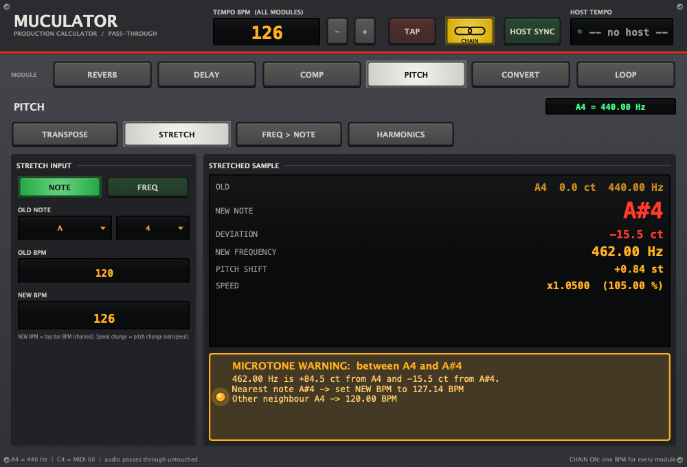
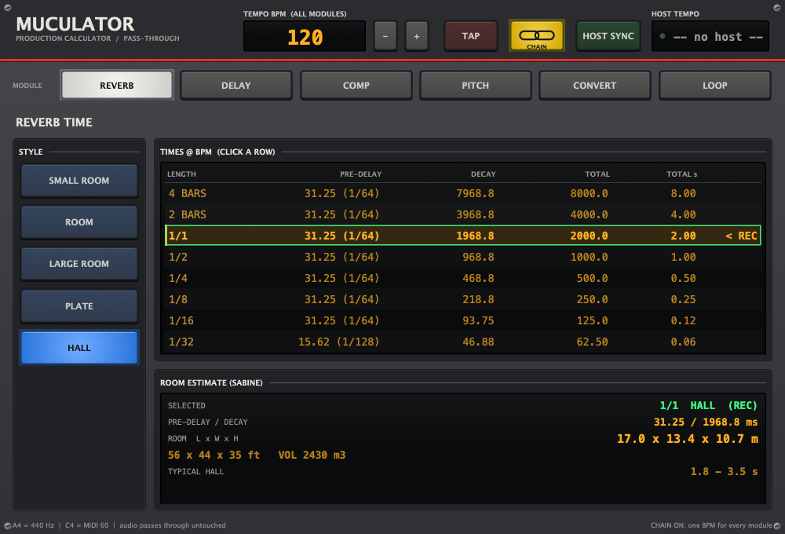
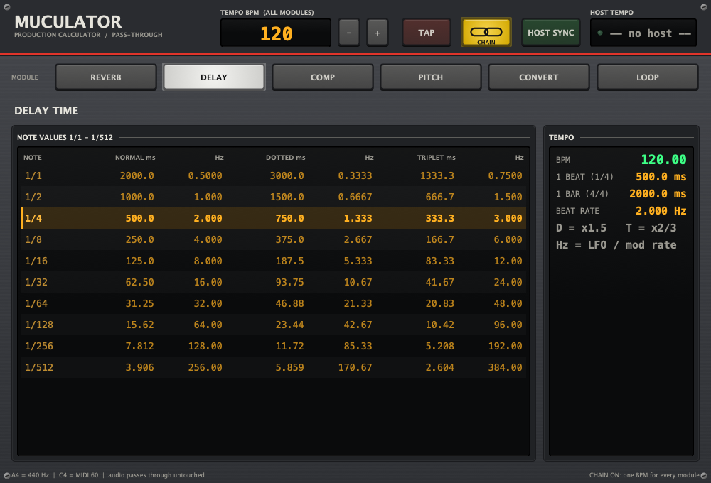
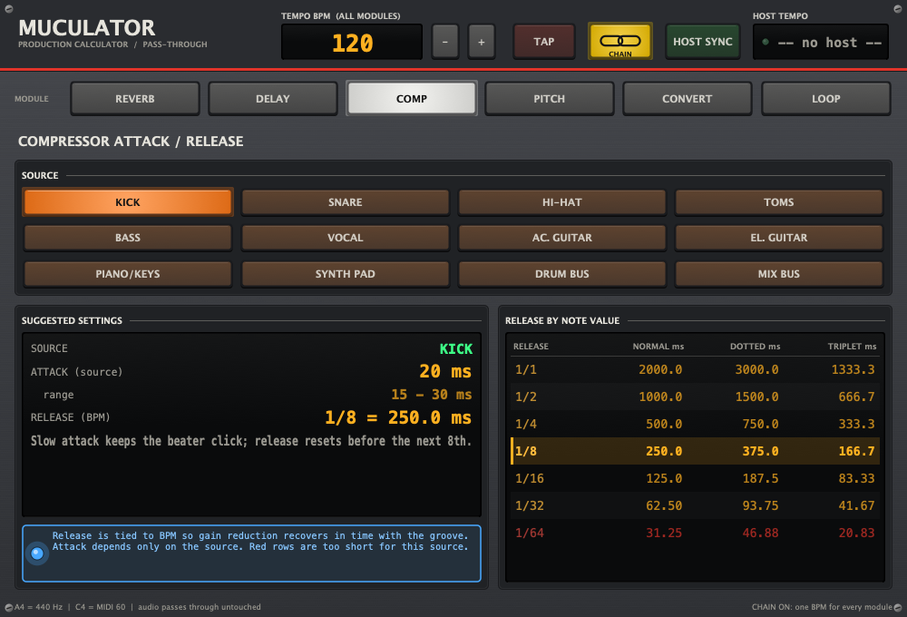
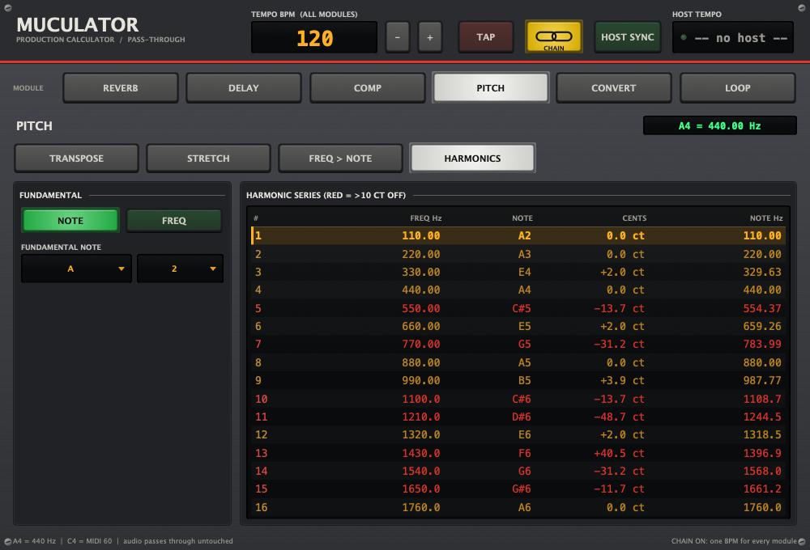
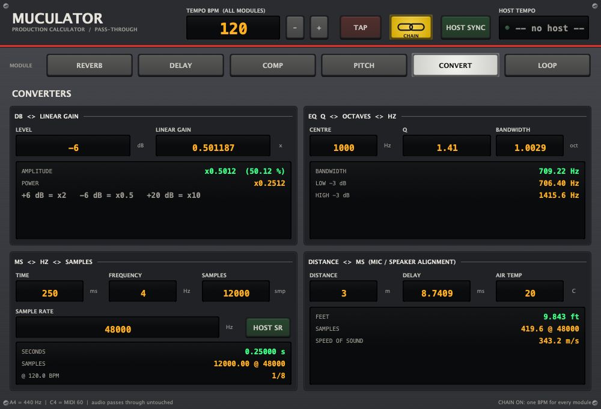
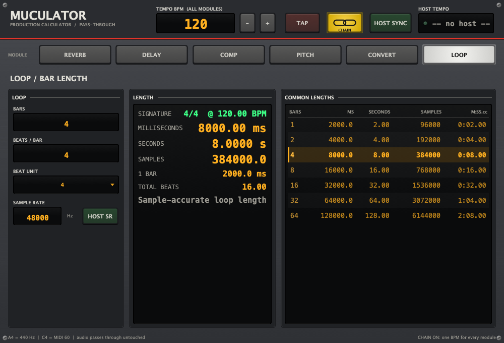

<div align="center">

# MUCULATOR

**The calculator rack for music producers.**
Free, open-source VST3 / AU plugin that does the studio maths for you: reverb and delay times, compressor timing, pitch after time-stretch, unit conversions and loop lengths, all locked to your tempo.



[**Download**](../../releases/latest) · [Features](#features) · [Build from source](#build-from-source) · [Türkçe](#türkçe)

</div>

---

## Why?

Every producer keeps a browser tab open for "BPM to ms", "what note is 462 Hz" or "what pre-delay for a hall at 128 BPM".
Muculator puts all of that inside your DAW, styled like a console channel strip: dark panel, LED displays, lit buttons.

- **Audio passes through untouched.** Drop it on any track; it costs no DSP.
- **Follows your DAW tempo** (Host Sync), or tap it in.
- **Chain mode:** one BPM drives every module, or unlink and give each module its own.
- **Never crashes on bad input.** Type `0`, `abc` or leave a field empty and you get a clear warning instead.

## Features

| Module | What it tells you |
|---|---|
| **Reverb** | Pre-delay, decay and total time for Small Room, Room, Large Room, Plate and Hall, synced to BPM. The recommended row is highlighted, you can click any row, and it shows an estimated room size (Sabine). |
| **Delay** | Every note value from 1/1 to 1/512: normal, dotted and triplet, in **ms and Hz**. |
| **Compressor** | Attack based on the source (kick, snare, bass, vocal, bus…) and release based on the tempo, with warnings when the release gets too short. |
| **Pitch** | **Transpose** (note ± semitones/cents), **Stretch**, **Frequency → Note**, **Harmonic series**. Reference A4 = 440 Hz is always on screen. |
| **Converters** | dB ↔ linear gain · EQ Q ↔ octaves ↔ Hz · ms ↔ Hz ↔ samples · distance ↔ ms (mic/speaker alignment). |
| **Loop** | Bars + time signature → ms, seconds and exact sample count. |

### The Stretch module

Changed the tempo of a sample? Enter the **old BPM**, the **old note** (or frequency) and the **new BPM**.
Muculator gives you the new note and frequency. If the result lands **between two notes** (10 cents or more off the nearest note), you get a **MICROTONE WARNING** telling you:

- which two notes it sits between,
- how many cents it is off from each,
- **which BPM to use** so the sample lands exactly on a note.

> Example: an A4 sample at 120 BPM played at 126 BPM → 462 Hz, −15.5 ct from A#4. Use **127.14 BPM** to land on A#4.

<details>
<summary><b>More screenshots</b></summary>

| | |
|---|---|
|  |  |
|  |  |
|  |  |

</details>

## Install

1. Download the zip for your system from [**Releases**](../../releases/latest).
2. Copy the plugin to:
   - **Windows (VST3):** `C:\Program Files\Common Files\VST3\`
   - **macOS (VST3):** `~/Library/Audio/Plug-Ins/VST3/`
   - **macOS (AU):** `~/Library/Audio/Plug-Ins/Components/`
3. Rescan plugins in your DAW. Muculator shows up as an effect.

> **macOS:** the builds are not notarized yet. If macOS blocks the plugin, run
> `xattr -cr ~/Library/Audio/Plug-Ins/VST3/Muculator.vst3` (and the same for `Muculator.component`).
>
> **Windows:** SmartScreen may warn about an unknown publisher; the plugin is unsigned.

## Build from source

You need CMake ≥ 3.22 and a C++20 compiler (Xcode / Command Line Tools on macOS, Visual Studio 2022 on Windows).
JUCE is downloaded automatically if it is not found locally.

```bash
cmake -S . -B build -DCMAKE_BUILD_TYPE=Release
cmake --build build --config Release
```

Artefacts end up in `build/Muculator_artefacts/Release/` (`VST3/`, `AU/`, `Standalone/`).

| Target | Purpose |
|---|---|
| `CalcTests` | Unit tests for every formula (`Source/Calc.cpp`, no JUCE dependency) |
| `MuculatorSnapshot` | Renders every screen to PNG, used to make the screenshots above |

Project layout:

```
Source/Calc.*            all maths: pure C++, unit tested
Source/Modules/          one file per module (Reverb, Delay, …)
Source/UI/               console look & feel, LED fields, lit buttons, tables
Source/Plugin*.cpp       pass-through processor + editor shell
Tests/                   unit tests + snapshot tool
```

## Assumptions & formulas

- 12-TET, A4 = 440 Hz, C4 = MIDI 60, notes written with sharps.
- Stretch = varispeed (tape-style): pitch ratio = new BPM / old BPM.
- Microtone warning when the shown deviation is ≥ 10 cents.
- Reverb pre-delay is snapped to the 1/64 to 1/512 note closest to each style's typical value, and is never more than 25 % of the tail. Room size comes from Sabine's formula with 1.59 : 1.26 : 1 proportions.
- Compressor suggestions are common starting points, not rules.
- Speed of sound = 331.3·√(1 + T/273.15) m/s.

## Contributing

Bug reports, ideas and pull requests are welcome. See [CONTRIBUTING.md](CONTRIBUTING.md).

## License

Copyright © 2026 prodairy. Muculator is free software under the **GNU AGPLv3** ([LICENSE](LICENSE)).
It is built with [JUCE](https://juce.com) (AGPLv3) and the Steinberg VST3 SDK (MIT).
VST is a registered trademark of Steinberg Media Technologies GmbH.

---

## Türkçe

**Muculator**, müzik prodüktörleri için ücretsiz ve açık kaynak bir VST3 / AU eklentisidir. Sesi değiştirmez; stüdyodaki hesapları DAW'ın içinde, tempona kilitli olarak yapar.

- **Reverb:** Tarza ve BPM'e göre pre-delay, decay ve toplam süre; önerilen satır işaretli; tahmini oda ölçüleri.
- **Delay:** 1/1'den 1/512'ye kadar normal, noktalı ve triplet süreler (ms ve Hz).
- **Compressor:** Kaynağa göre attack, BPM'e göre release.
- **Pitch:** Transpose, Stretch, frekanstan nota bulma, harmonik serisi (A4 = 440 Hz hep ekranda).
- **Converters:** dB ↔ gain, Q ↔ oktav ↔ Hz, ms ↔ Hz ↔ sample, mesafe ↔ ms.
- **Loop:** Bar sayısından ms, saniye ve sample sayısı.

**Stretch:** Eski BPM'i, eski notayı ve yeni BPM'i girersin; yeni notayı ve frekansı verir. Sonuç iki notanın arasında kalırsa **MİKROTON UYARISI** gösterir ve notaya tam oturması için hangi BPM'i kullanman gerektiğini yazar.

**Kurulum:** [Releases](../../releases/latest) sayfasından kendi sistemine uygun zip dosyasını indir, eklentiyi yukarıdaki klasöre kopyala ve DAW'da eklentileri yeniden tarat.
